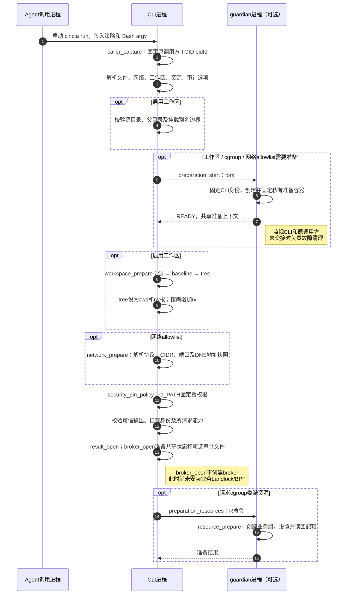
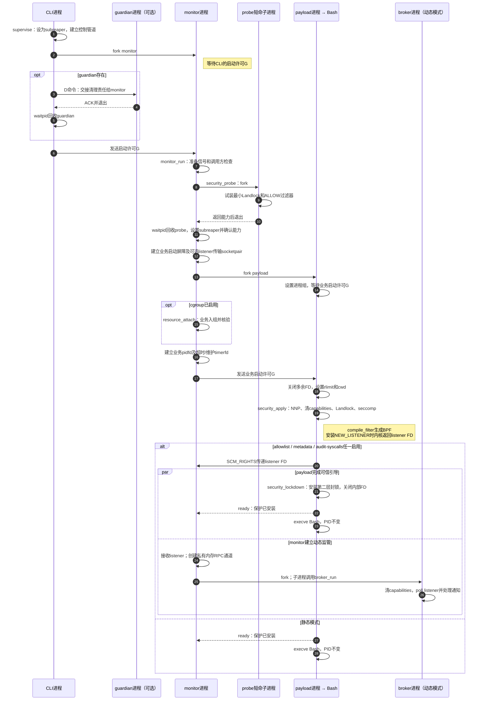
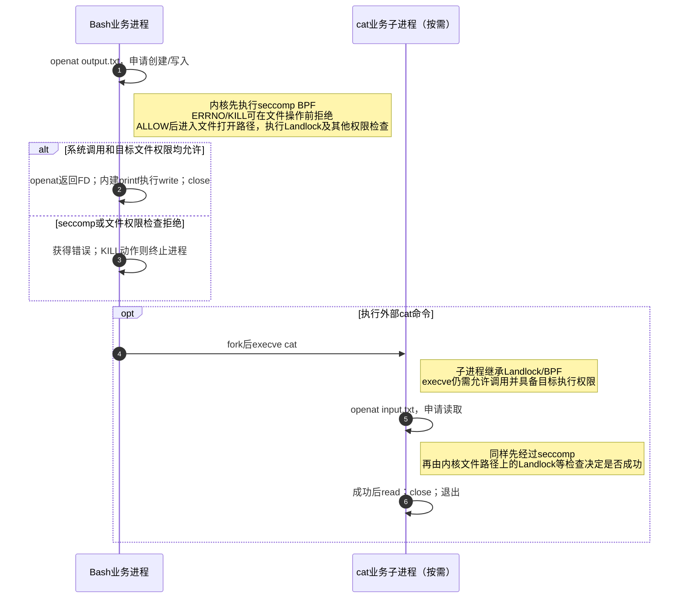
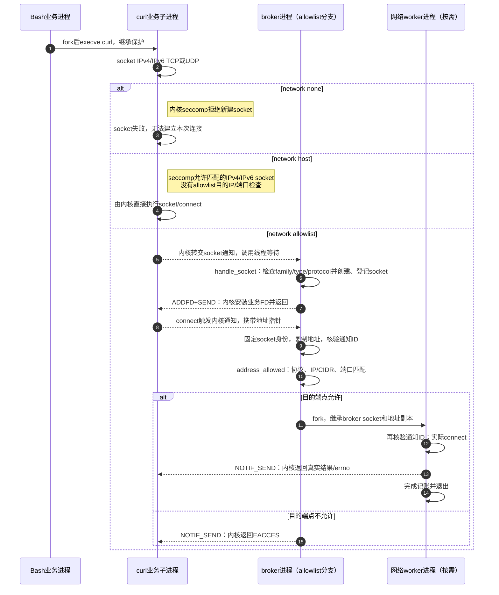
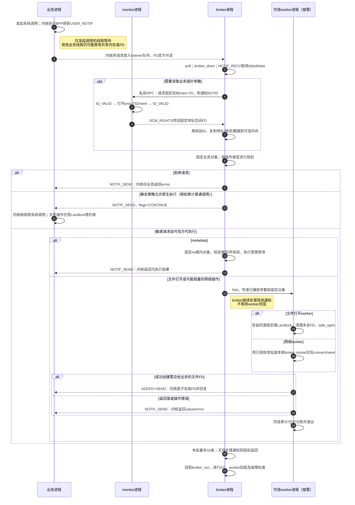
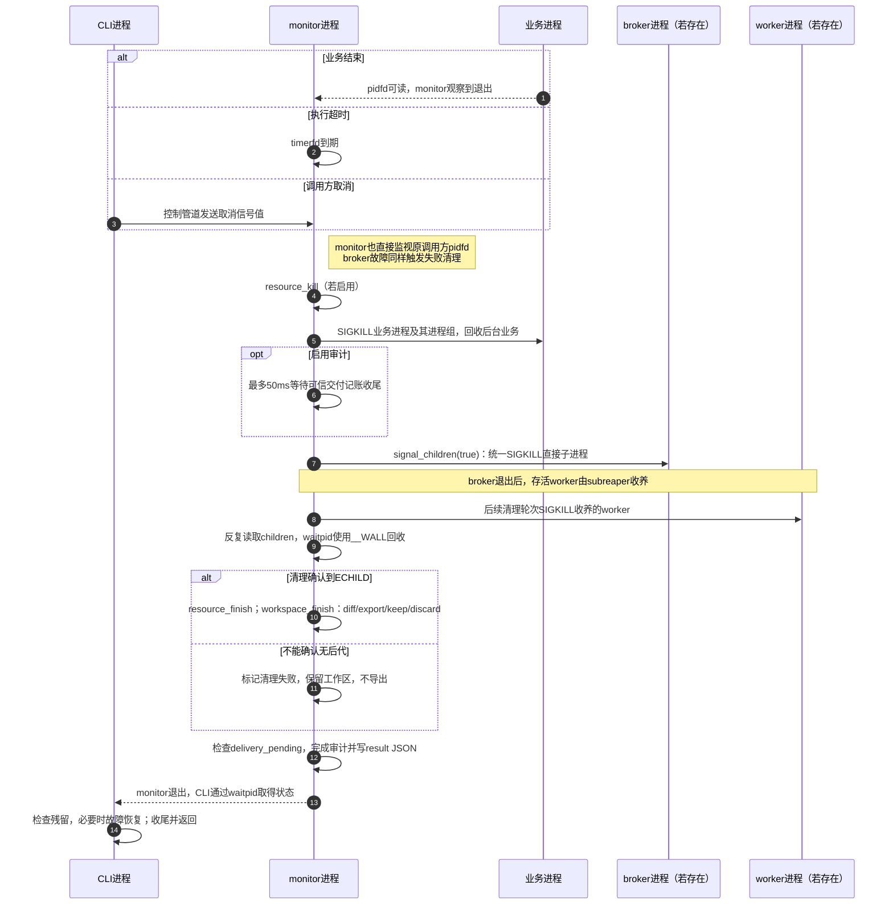

# 按进程阅读执行时序

对照代码基线：`4983eab`，`0.2.0-preview.1`。本文仅补充阅读图，不改变执行行为。

所有 `participant` 方框都代表真实进程；自调用箭头表示该进程中的函数执行或系统调用，注释说明内核处理。标为“内核转交”的跨进程箭头表示 seccomp 通知/响应，不表示业务主动给 broker 发送 IPC，也不是 Unix signal。各图的垂直顺序表示必要的先后关系；`par` 内的分支并发推进。

示例把业务命令设为 `/bin/bash -c ...`。payload 经 `execve` 变成 Bash，PID 不变；外部命令如 curl 通常另有子进程。各子孙继承已安装的保护。CLI、monitor、broker、guardian 都是同一程序通过 fork 分出的不同进程。

原调用方在当前PID namespace不可见时不能绑定其生命周期，会通过结果中的 `protections.caller_bound=false` 明确报告，取消需由容器运行时等发送信号。

## 1A. 初始化：配置、工作区与资源准备

工作区实际复制由 CLI 执行，guardian 负责准备容器身份和故障兜底；baseline 与 tree 是独立物理副本。无任何上述准备需求时不创建 guardian。任何必需校验或准备失败都不会进入业务执行。

源码：[main](../src/main.c)、[preparation](../src/preparation.c)、[workspace](../src/workspace.c)、[resources](../src/resources.c)。

## 1B. 初始化：进程启动、保护安装及listener交接

NNP 指 `no_new_privs`。保护安装失败时 payload 报错退出，不执行 Bash。Bash 不必等 broker 被调度后才 exec；若先命中 USER_NOTIF，其发起调用的线程在内核等待。两个 G 是不同管道上的两道屏障。私有内存 RPC 通道在 payload fork 后创建，不会被业务继承。单独 `--audit` 不创建 listener/broker。

源码：[supervise / monitor_run / payload](../src/supervisor.c)、[security_probe / security_apply / security_lockdown](../src/security.c)。

## 2A. Bash访问文件：静态seccomp与Landlock

本图不启用 `--audit-syscalls`，例子为 Bash 内建 `printf hi > output.txt` 和外部 `cat input.txt`。

Landlock/BPF 不是用户态服务进程，因此不另画参与方方框。Landlock 并非在每次普通 `read/write` 时重新按路径授权；成功打开的 FD 本身就是已有能力。路径打开、执行等检查与后续 FD 操作要分别理解。stdio 也是调用方已授予的能力。开启 syscall 审计时，支持的文件打开会走图3的文件 worker 分支。

源码：[install_landlock / compile_filter](../src/security.c)、[payload](../src/supervisor.c)。

## 2B. Bash调用curl：网络策略如何生效

本图为突出网络模式差异，未启用 syscall 审计；其通知接管见图3。端点白名单由可信 broker 执行，不是 Landlock 检查 IP。域名已在图1A解析为地址快照。`sendto/sendmsg/sendmmsg` 同样复制并检查目标；已连接 socket 的普通 `write` 使用已获准 peer，不表示每个数据包都经过 broker。库、证书、配置等文件仍受 Landlock 文件授权限制。图中网络 worker 不安装业务文件 Landlock；文件打开 worker 则必须安装，见图3。

源码：[network_handle / handle_socket / handle_connect / handle_send](../src/network.c)。

## 3. USER_NOTIF：接收、参数固定、代执行与响应

listener 已按图1B传递；本图展开单条通知。箭头上“内核”表示通过 seccomp 通知设施转交。

敏感指针操作使用可信副本代执行，不采用“检查地址后 CONTINUE、让业务重读可变指针”的授权方式。`socket()` 不需要读取业务地址指针，由 broker 直接创建并 `ADDFD+SEND`，见图2B。文件打开审计有一个明确例外：旧内核无法 ADDFD 传递 O_PATH 时，仅在该特定失败条件下记录 native fallback，再在业务已有 Landlock 下 CONTINUE；这不算观察到原生调用完成。

一批32条是数量上限，不是时间上限；poll就绪与接收之间通知可能失效，RECV仍可能阻塞。已经发生的获准网络/文件副作用不能由通知取消回滚。审计失败或交付记账不完整会使最终任务失败。

源码：[broker_drain / broker_memory_open / broker_service_memory](../src/broker.c)、[filebroker_handle / perform_open](../src/filebroker.c)、[network_handle](../src/network.c)。

## 4. 补充：正常结束、超时或取消后的回收

循环有清理时间预算，不承诺不可中断内核任务一定及时退出；只有实际观察到 `ECHILD` 才声明 `cleanup_complete=true`。CLI/monitor任一层单独失效由存活subreaper兜底，两层同时被强杀不在该保证内。broker通常由上述统一清理终止；它自身遇到审计、通知或poll错误也会返回125。listener HUP时它等待monitor终止，而非提前报告故障退出。

源码：[monitor_run / signal_children / finish / supervise](../src/supervisor.c)、[broker_run](../src/broker.c)。
